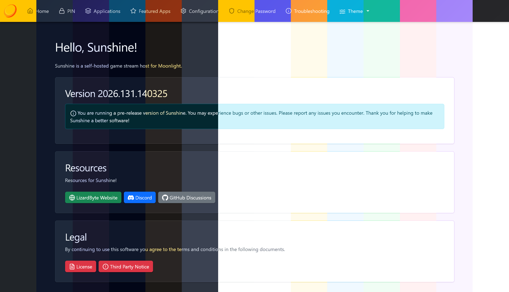
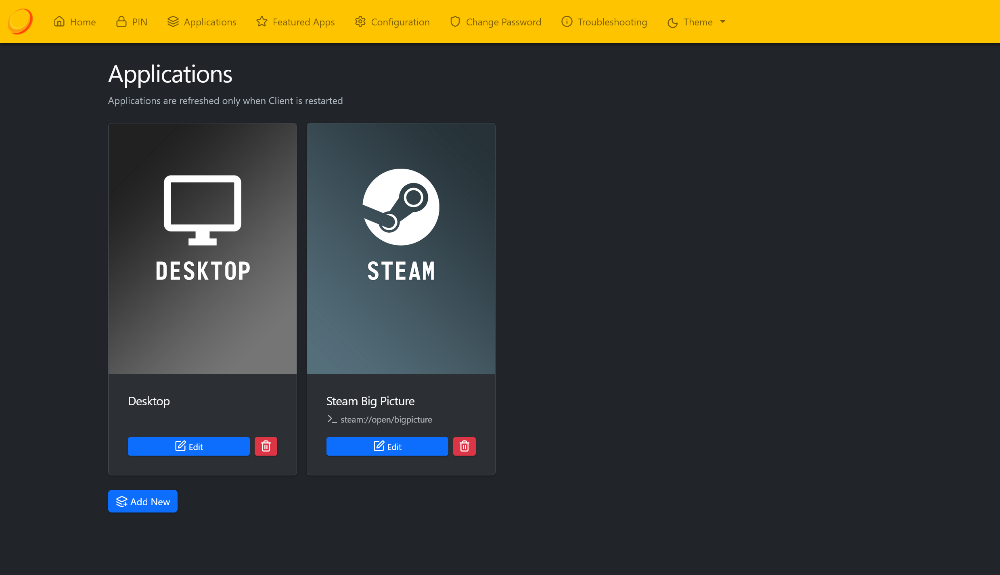
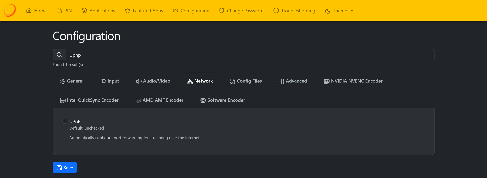
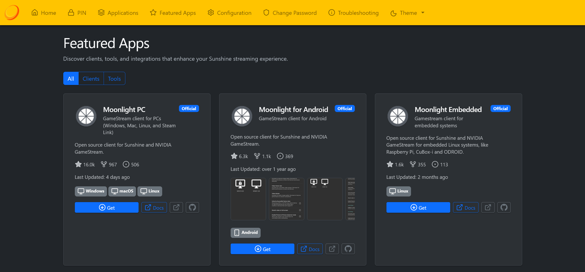
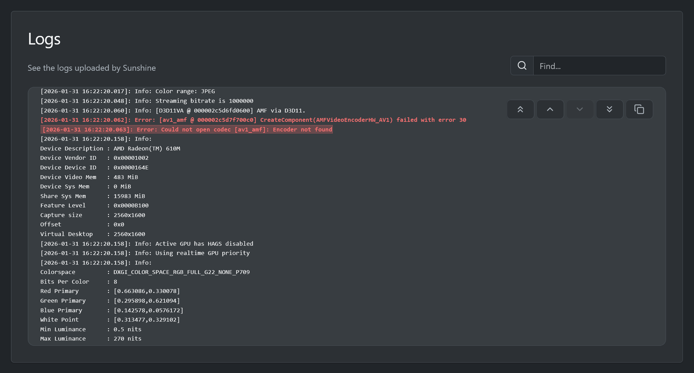

# Getting Started

The recommended method for running KLOUD_GAMES is to use the [binaries](#binaries) included in the
[latest release][latest-release], unless otherwise specified.

[Pre-releases](https://github.com/KLOUD_GAMESStream/KLOUD_GAMES/releases) are also available. These should be considered beta,
and release artifacts may be missing when merging changes on a faster cadence.

## Binaries

Binaries of KLOUD_GAMES are created for each release. They are available for Windows.
Binaries can be found in the [latest release][latest-release].

> [!NOTE]
> Some third party packages also exist.
> See [Third Party Packages](third_party_packages.md) for more information.
> No support will be provided for third party packages!

## Install

### Windows

> [!NOTE]
> KLOUD_GAMES supports ARM64 on Windows; however, this should be considered experimental. This version does not properly
> support GPU scheduling and any hardware acceleration.

#### Installer (recommended)

> [!CAUTION]
> The msi installer is preferred moving forward. Before using a different type of installer, you should manually
> uninstall the previous installation.

1. Download and install based on your architecture:

   | Architecture          | Installer                                                                                                                                    |
   |-----------------------|----------------------------------------------------------------------------------------------------------------------------------------------|
   | AMD64/x64 (Intel/AMD) | [KLOUD_GAMES-Windows-AMD64-installer.msi](https://github.com/KLOUD_GAMESStream/KLOUD_GAMES/releases/latest/download/KLOUD_GAMES-Windows-AMD64-installer.msi) |
   | ARM64                 | [KLOUD_GAMES-Windows-ARM64-installer.msi](https://github.com/KLOUD_GAMESStream/KLOUD_GAMES/releases/latest/download/KLOUD_GAMES-Windows-ARM64-installer.msi) |

> [!TIP]
> Installer logs can be found in the following directory:
> `%%TEMP%/KLOUD_GAMES/logs/install/`

> [!CAUTION]
> You should carefully select or unselect the options you want to install. Do not blindly install or
> enable features.

To uninstall, find KLOUD_GAMES in the list <a href="ms-settings:installed-apps">here</a> and select "Uninstall" from the
overflow menu. Different versions of Windows may provide slightly different steps for uninstall.

#### Standalone (lite version)

> [!WARNING]
> By using this package instead of the installer, performance will be reduced. This package is not
> recommended for most users. No support will be provided!

1. Download and extract based on your architecture:

   | Architecture          | Installer                                                                                                                          |
   |-----------------------|------------------------------------------------------------------------------------------------------------------------------------|
   | AMD64/x64 (Intel/AMD) | [KLOUD_GAMES-Windows-AMD64-lite.zip](https://github.com/KLOUD_GAMESStream/KLOUD_GAMES/releases/latest/download/KLOUD_GAMES-Windows-AMD64-lite.zip) |
   | ARM64                 | [KLOUD_GAMES-Windows-ARM64-lite.zip](https://github.com/KLOUD_GAMESStream/KLOUD_GAMES/releases/latest/download/KLOUD_GAMES-Windows-ARM64lite.zip)  |

2. Open command prompt as administrator
3. Firewall rules

   Install:
   ```bash
   cd /d {path to extracted directory}
   scripts/add-firewall-rule.bat
   ```

   Uninstall:
   ```bash
   cd /d {path to extracted directory}
   scripts/delete-firewall-rule.bat
   ```

4. Windows service

   Install:
   ```bash
   cd /d {path to extracted directory}
   scripts/install-service.bat
   scripts/autostart-service.bat
   ```

   Uninstall:
   ```bash
   cd /d {path to extracted directory}
   scripts/uninstall-service.bat
   ```

## Initial Setup
After installation, some initial setup is required.

### Windows
KLOUD_GAMES supports two virtual gamepad backends on Windows. You can install the
[Virtual HID Broker](https://github.com/LizardByte/libvirtualhid/releases/latest) separately as an optional paid upgrade.
Its Windows package includes a broker service and user-mode driver for a Raw Input keyboard and mouse plus full virtual
gamepad support. ViGEmBus remains available as a limited alternative for Xbox 360 and DualShock 4 gamepads, but it has reached end of life.

When Virtual HID Broker is used, KLOUD_GAMES requires libvirtualhid version `2026.914.1218.10` or newer.

Compared with the ViGEmBus fallback, Virtual HID Broker can create Xbox One, Xbox Series, DualSense, Nintendo Switch
Pro, and Generic gamepads in addition to Xbox 360 and DualShock 4. It can also expose controller-specific features such
as motion, touchpads, LEDs, and adaptive triggers when supported. Virtual HID Broker is actively developed and
supported by the LizardByte team.

With a compatible driver and active license, normal key transitions are exposed through a real HID keyboard so
applications using Raw Input can receive them. Unicode text input and keys outside the supported HID keyboard page
continue to use Windows input injection. When the driver-backed keyboard cannot be created because the driver,
broker, or license is unavailable, libvirtualhid retains its legacy SendInput fallback.

Relative mouse movement, buttons, and scrolling are exposed as a real HID
mouse so applications using Raw Input can receive them. Absolute mouse positioning continues to use Windows input
injection. When the driver-backed mouse cannot be created, libvirtualhid retains its legacy SendInput fallback.

The Virtual HID Broker requires an active paid machine license for driver-backed devices, including gamepads and the Raw
Input keyboard and mouse. KLOUD_GAMES shows the current license status and actions on the Web UI Troubleshooting page and
in the **Virtual HID Broker** system tray submenu. In **Configuration > Input**, choose whether KLOUD_GAMES may use **All
Available Drivers**, only **Virtual HID Broker**, or only **ViGEmBus**. KLOUD_GAMES continues to show the selection prompt
until this setting is saved. If an active Virtual HID Broker license is already present, KLOUD_GAMES selects **All Available
Drivers** automatically. That policy prefers Virtual HID Broker. When its license is not valid, KLOUD_GAMES falls back to
ViGEmBus for Xbox 360 and DualShock 4 gamepads and to SendInput for keyboard and mouse. Selecting only **ViGEmBus**
suppresses Virtual HID Broker startup notifications and limits the available emulated gamepads to Xbox 360 and
DualShock 4. **None** disables all virtual gamepads and their startup notices without affecting keyboard or mouse
input. KLOUD_GAMES recreates the shared keyboard and mouse after a successful license action, so switching between
the HID and SendInput paths does not require restarting KLOUD_GAMES.

After installing or updating virtual input drivers, it is recommended to restart your computer.

## Usage

### Basic usage
If KLOUD_GAMES is not installed/running as a service, then start KLOUD_GAMES with the following command, unless a start
command is listed in the specified package [install](#install) instructions above.

> [!NOTE]
> A service is a process that runs in the background. This is the default when installing KLOUD_GAMES from the
> Windows installer. Running multiple instances of KLOUD_GAMES is not advised.

```bash
KLOUD_GAMES
```

### Specify config file
```bash
KLOUD_GAMES <directory of conf file>/KLOUD_GAMES.conf
```

> [!NOTE]
> This step is optional, you do not need to specify a config file.
> If no config file is entered, the default location will be used.
> The configuration file specified will be created if it doesn't exist.

### Configuration

KLOUD_GAMES is configured via the web ui, which is available on [https://localhost:47990](https://localhost:47990)
by default. You may replace *localhost* with your internal ip address.

> [!NOTE]
> Ignore any warning given by your browser about "insecure website". This is due to the SSL certificate
> being self-signed.

> [!CAUTION]
> If running for the first time, make sure to note the username and password that you created.

1. Change the web-ui to your desired theme, using the dropdown menu in the navbar.
   
2. Add games and applications.
   
3. Adjust any configuration settings as needed. You can search for options in the search bar.
   
4. Find Moonlight clients and other tools for KLOUD_GAMES in the `Featured Apps` tab.
   
5. In Moonlight, you may need to add the PC manually.
6. When Moonlight requests for you insert the pin:

   - Login to the web-ui
   - Go to "PIN" in the Navbar
   - Type in your PIN and press `Enter`, and enter a name of your choosing for the device.
     You should get a Success Message!
   - In Moonlight, select one of the Applications listed

7. If you run into issues, logs are available in the `Troubleshooting` tab.
   You can navigate through each warning/error message for clues to the issue.

   

### Arguments
To get a list of available arguments, run the following command.

```bash
KLOUD_GAMES --help
```

### Shortcuts
All shortcuts start with `Ctrl+Alt+Shift`, just like Moonlight.

* `Ctrl+Alt+Shift+N`: Hide/Unhide the cursor (This may be useful for Remote Desktop Mode for Moonlight)
* `Ctrl+Alt+Shift+F1/F12`: Switch to different monitor for Streaming

### Application List
* Applications should be configured via the web UI
* A basic understanding of working directories and commands is required
* You can use Environment variables in place of values
* `$(HOME)` will be replaced by the value of `$HOME`
* `$$` will be replaced by `$`, e.g. `$$(HOME)` will be become `$(HOME)`
* `env` - Adds or overwrites Environment variables for the commands/applications run by KLOUD_GAMES.
  This can only be changed by modifying the `apps.json` file directly.

### Considerations
* On Windows, KLOUD_GAMES uses the Desktop Duplication API which only supports capturing from the GPU used for display.
  If you want to capture and encode on the eGPU, connect a display or HDMI dummy display dongle to it and run the games
  on that display.
* When an application is started, if there is an application already running, it will be terminated.
* If any of the prep-commands fail, starting the application is aborted.
* When the application has been shutdown, the stream shuts down as well.

  * For example, if you attempt to run `steam` as a `cmd` instead of `detached` the stream will immediately fail.
    This is due to the method in which the steam process is executed. Other applications may behave similarly.
  * This does not apply to `detached` applications.

* The "Desktop" app works the same as any other application except it has no commands. It does not start an application,
  instead it simply starts a stream. If you removed it and would like to get it back, just add a new application with
  the name "Desktop" and "desktop.png" as the image path.

### HDR Support
Streaming HDR content is officially supported on Windows hosts.

* General HDR support information and requirements:

  * HDR must be activated in the host OS, which may require an HDR-capable display or EDID emulator dongle
    connected to your host PC.
  * You must also enable the HDR option in your Moonlight client settings, otherwise the stream will be SDR
    (and probably overexposed if your host is HDR).
  * A good HDR experience relies on proper HDR display calibration both in the OS and in game. HDR calibration can
    differ significantly between client and host displays.
  * You may also need to tune the brightness slider or HDR calibration options in game to the different HDR brightness
    capabilities of your client's display.
  * Some GPUs video encoders can produce lower image quality or encoding performance when streaming in HDR compared
    to SDR.

Additional information:

@tabs_grouped{platform|:|
  @tab{ Windows |:|
  - HDR streaming is supported for Intel, AMD, and NVIDIA GPUs that support encoding HEVC Main 10 or AV1 10-bit profiles.
  - We recommend calibrating the display by streaming the Windows HDR Calibration app to your client device and saving an HDR calibration profile to use while streaming.
  - Older games that use NVIDIA-specific NVAPI HDR rather than native Windows HDR support may not display properly in HDR.
  }
}

### Tutorials and Guides
Tutorial videos are available [here](https://www.youtube.com/playlist?list=PLMYr5_xSeuXAbhxYHz86hA1eCDugoxXY0).

Guides are available [here](guides.md).

@admonition{Community! |:|
Tutorials and Guides are community generated. Want to contribute? Reach out to us on our discord server.}


[latest-release]: https://github.com/KLOUD_GAMESStream/KLOUD_GAMES/releases/latest
